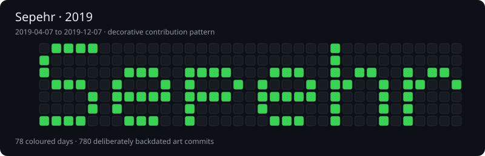
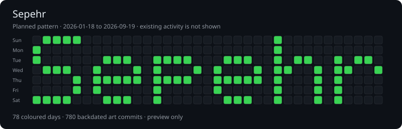

# Sepehr contribution art

This repository contains decorative, deliberately backdated commits that draw
**Sepehr** in GitHub contribution calendars for **2019–2026**. These commits
are generated art rather than records of development activity on those dates.

There are 780 art commits per year, arranged across 78 coloured days.
Existing genuine contributions remain visible and may add a few extra cells.

## Patterns

### 2019

### 2020

### 2021

### 2022

### 2023

### 2024

### 2025

### 2026

The date-list method is inspired by
https://github.com/jameskaois/hack-github-contribution-graph.
